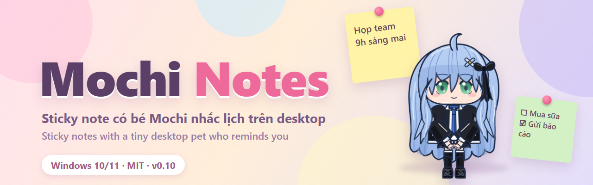
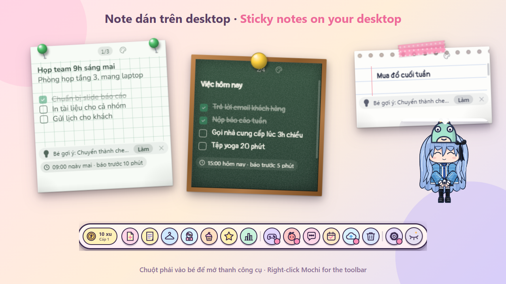
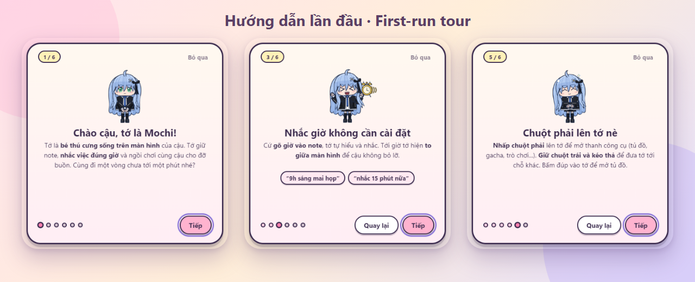
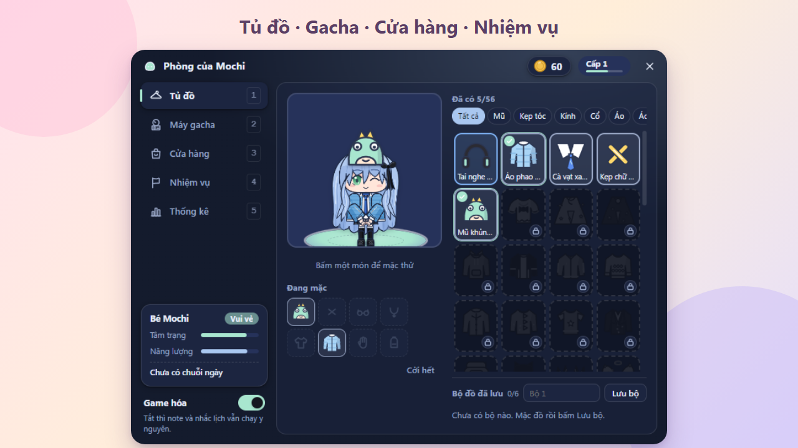
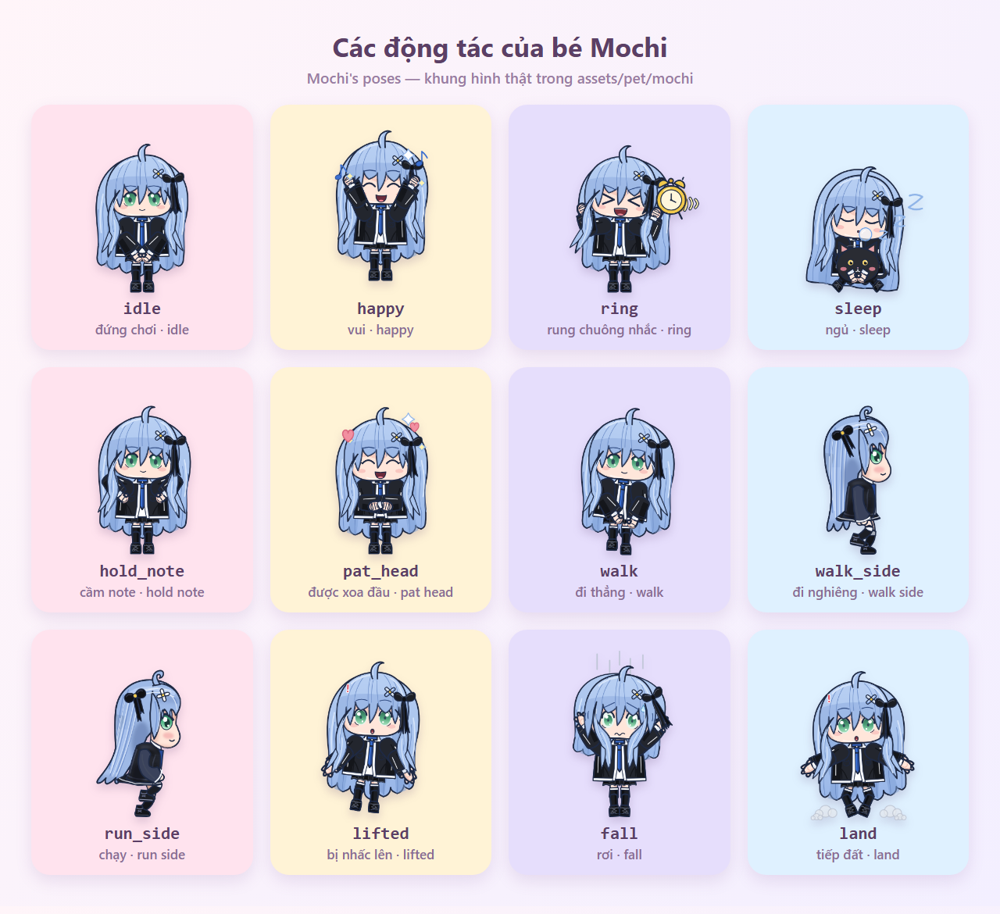

<div align="center">



<p>
  <a href="https://github.com/kaito111234/mochi-notes/releases/latest"></a>
  <a href="https://github.com/kaito111234/mochi-notes/releases"></a>
  <a href="LICENSE"></a>
  
</p>
<p>
  <a href="https://github.com/kaito111234/mochi-notes/actions/workflows/release.yml"></a>
  <a href="https://github.com/kaito111234/mochi-notes/actions/workflows/ci.yml"></a>
  
</p>

&nbsp;&nbsp;

**Tiếng Việt** · [English](#english)

</div>

## Mục lục

- [Giới thiệu](#giới-thiệu)
- [Tính năng](#tính-năng)
- [Ảnh chụp](#ảnh-chụp)
- [Cài đặt](#cài-đặt)
- [Hướng dẫn nhanh](#hướng-dẫn-nhanh)
- [Cho nhà phát triển](#cho-nhà-phát-triển)
- [Đóng góp](#đóng-góp) · [Giấy phép](#giấy-phép) · [Cảm ơn](#cảm-ơn)
- [English](#english)

## Giới thiệu

**Mochi Notes** là ứng dụng **sticky note cho Windows** kèm một **thú cưng desktop tên Mochi**. Bạn dán note lên màn hình, gõ giờ bằng tiếng Việt tự nhiên ("họp 9h sáng mai", "nhắc 15 phút nữa") và bé Mochi sẽ tự chạy ra nhắc đúng giờ: gõ cửa, rung chuông, hoặc nhảy ra giữa màn hình nếu bạn lơ đi. Dữ liệu nằm hoàn toàn trên máy bạn, mã nguồn mở theo giấy phép MIT.

## Tính năng

- **Note dán trên desktop**: nhiều màu, nhiều kiểu giấy (giấy ô li, bảng phấn, thẻ ghi chú...), ghim/kẹp/băng keo, checklist, đung đưa khi kéo, danh sách note, thùng rác khôi phục được.
- **Nhắc giờ hiểu tiếng Việt tự nhiên**: gõ "9h sáng mai họp", "nhắc 15 phút nữa", "15h gọi khách"; gõ không dấu cũng hiểu. Có nhắc lặp, báo trước, hoãn nhắc.
- **Nhắc to giữa màn hình**: tới giờ mà bạn chưa phản ứng, bé Mochi nhảy ra giữa màn hình và đập tay "bốp"; càng để lâu bé càng giận (5 mức).
- **Biết nhẹ tay**: **giờ yên lặng** (mặc định 22:00 đến 07:00) giảm tiếng; tự nhận ra khi bạn **đang họp / chia sẻ màn hình / chạy toàn màn hình** (Zoom, Teams, Meet, Webex...) thì chỉ nhắc nhẹ ở góc thay vì đập màn hình.
- **Ra lệnh cho bé**: gõ trong note "bé ơi, dọn dẹp", "bé ơi, tập trung 25 phút", hoặc bấm `Ctrl+Alt+B` để mở ô lệnh nhanh. Hiểu cả câu nói tự nhiên lẫn gõ không dấu.
- **Bé Mochi sống động**: đi, chạy, ngủ trong giường, ngồi đọc sách, uống trà, múa hát, bị nhấc lên/ném/xoa đầu; tự dọn note hết hạn vào thùng rác; có thanh công cụ kiểu game khi bấm chuột phải.
- **Tủ đồ, gacha, cửa hàng, nhiệm vụ**: kiếm xu khi dùng note, quay gacha, mặc đồ cho bé (mũ, áo, kính, phụ kiện...), nhận nhiệm vụ, xem thống kê. Có thể tắt game hoá mà note và nhắc giờ vẫn chạy bình thường.
- **Tập trung (Focus) 25 phút**, checklist lặp hằng ngày, tổng kết cuối ngày.
- **Sao lưu**: tự sao lưu note ra thư mục bạn chọn (nên chọn trong **OneDrive / Google Drive**) tự động khi có thay đổi (tối đa 10 phút/lần) và khi tắt app, giữ 30 bản gần nhất; khôi phục ngay trong menu khay.
- **Tự cập nhật** qua GitHub Releases.
- **Hướng dẫn lần đầu** ngắn 6 bước cho người mới.
- **Riêng tư và nhẹ**: dữ liệu lưu cục bộ, không tài khoản, không theo dõi; gỡ cài đặt không xoá note.

## Ảnh chụp

<p align="center">
  
</p>
<p align="center">
  
</p>
<p align="center">
  
</p>
<p align="center">
  
</p>

<details>
<summary><b>Các động tác của bé Mochi</b></summary>
<p align="center"></p>
</details>

## Cài đặt

Tải ở trang [**Releases**](https://github.com/kaito111234/mochi-notes/releases/latest) (Windows 10/11):

| Tệp | Dành cho |
| --- | --- |
| `MochiNotes-Setup-<version>-x64.exe` | Windows Intel/AMD. Cài một chạm, **không cần quyền admin**, tự tạo lối tắt, tự cập nhật. Khuyên dùng. |
| `MochiNotes-Setup-<version>-arm64.exe` | Windows trên chip ARM. |
| `MochiNotes-Portable-<version>.exe` | Chạy thẳng không cần cài (x64). |
| `MochiNotes-<version>-x64.zip` | Giải nén rồi chạy `Mochi Notes.exe`. |

Cài im lặng (cho script): `MochiNotes-Setup-<version>-x64.exe /S`.

### Cảnh báo SmartScreen

Bản cài chưa được ký số nên lần đầu Windows có thể hiện **"Windows protected your PC"**. Đây là bình thường với phần mềm mới:

1. Bấm **More info** (Thông tin thêm).
2. Bấm **Run anyway** (Vẫn chạy).

Để chắc file tải về không bị sửa, so SHA256 với `SHA256SUMS.txt` đính kèm mỗi bản phát hành:

```powershell
certutil -hashfile MochiNotes-Setup-<version>-x64.exe SHA256
```

Chi tiết: [docs/signing.md](docs/signing.md).

### Gỡ cài đặt và dữ liệu

- Gỡ qua **Settings → Apps** như bình thường. **Gỡ cài đặt không xoá note** của bạn.
- Dữ liệu (note, cài đặt, tiến trình game) nằm ở `%APPDATA%\Mochi Notes`. Muốn sao lưu thủ công chỉ cần chép thư mục này, hoặc dùng sao lưu tự động trong menu của bé.

## Hướng dẫn nhanh

### Phím tắt (dùng được mọi lúc)

| Phím | Việc |
| --- | --- |
| `Ctrl+Alt+N` | Tạo note mới |
| `Ctrl+Alt+H` | Ẩn/hiện tất cả note |
| `Ctrl+Alt+L` | Mở danh sách note |
| `Ctrl+Alt+M` | Gọi bé Mochi ra |
| `Ctrl+Alt+G` | Mở phòng game (tủ đồ, gacha...) |
| `Ctrl+Alt+B` | Ô gõ lệnh nhanh cho bé |

Bấm **chuột phải** vào bé để mở thanh công cụ; giữ chuột trái và kéo để đưa bé đi chỗ khác; bấm đúp để mở tủ đồ.

### Ví dụ câu nhắc

Gõ vào note, bé tự hiểu giờ và nhắc:

- `9h sáng mai họp`
- `nhắc 15 phút nữa`
- `họp 3h chiều nay`
- `15h gọi khách`

### Ví dụ lệnh cho bé

Gõ trong note bắt đầu bằng "bé ơi, ..." rồi dừng tay, hoặc gõ vào ô `Ctrl+Alt+B`:

- Dọn: `dọn dẹp`, `dọn note trống`, `dọn note hết hạn`, `xoá note này`
- Xếp: `xếp note lại`, `ẩn hết note`, `hiện hết note`, `mở thùng rác`, `danh sách`
- Việc: `tạo note mua sữa`, `nhắc tớ uống nước lúc 15h`, `gõ cửa nhắc việc`
- Tập trung: `tập trung 25 phút`, `dừng tập trung`, `lặp hằng ngày`, `tổng kết hôm nay`, `sao lưu`
- Chơi: `múa`, `hát`, `tập thể dục`, `đi ngủ`, `thức dậy`, `mở tủ đồ`, `quay gacha`, `đọc sách`, `uống trà`...
- Nói hai việc một lúc cũng được: `dọn dẹp rồi xếp note lại`. Gõ `bé ơi, giúp` để xem danh sách đầy đủ.

## Cho nhà phát triển

Yêu cầu: Node.js 20+, Windows.

```bash
npm ci
npm start        # chạy thử app
npm test         # test NLU, lõi, chính sách nhắc to, kiểm gói hình
npm run dist     # build bộ cài NSIS x64 (không publish) -> dist/
npm run dist:full  # NSIS x64 + arm64, portable, zip
```

Chạy với dữ liệu riêng để không đụng note thật: đặt biến môi trường `MOCHI_DATA_DIR` trỏ tới một thư mục trống.

### Cấu trúc thư mục

```
src/main/      tiến trình chính: store, tray, updater, nhắc giờ, bé Mochi (petcore, antics), game, sao lưu
src/note/      giao diện note (editor, checklist, giấy, ghim)
src/pet/       cửa sổ bé Mochi, hoạt ảnh
src/alert/     màn nhắc to giữa màn hình
src/game/      phòng game: tủ đồ, gacha, cửa hàng, nhiệm vụ, thống kê
src/shared/    phân tích tiếng Việt (giờ, lệnh), hội thoại, đồ mặc
assets/        hình bé Mochi, giấy, font, icon (xem ASSETS-NOTICE.md)
tools/         test, kiểm gói hình, công cụ dựng ảnh (make-gif.js)
docs/          hướng dẫn phát hành, ký số, ảnh README
.github/       workflow CI và phát hành, mẫu issue/PR
```

### Phát hành

Tăng version bằng `npm version X.Y.Z --no-git-tag-version`, commit, rồi đẩy tag `vX.Y.Z`. Workflow [release.yml](.github/workflows/release.yml) tự build trên GitHub Actions và đưa tệp lên Releases (kèm `latest.yml` cho tự cập nhật và `SHA256SUMS.txt`). Chi tiết: [docs/release.md](docs/release.md). CI chạy test mỗi lần push/PR ([ci.yml](.github/workflows/ci.yml)).

Dựng lại ảnh động trong README: `node tools/make-gif.js assets/pet/mochi/walk_side/normal/loop docs/images/mochi-walk.gif --size 200`.

## Đóng góp

Rất hoan nghênh issue và pull request. Xem [CONTRIBUTING.md](CONTRIBUTING.md). Hãy chạy `npm test` trước khi gửi PR, và mở issue trước khi làm thay đổi lớn. Dùng mẫu [báo lỗi](.github/ISSUE_TEMPLATE/bug_report.yml) hoặc [đề xuất tính năng](.github/ISSUE_TEMPLATE/feature_request.yml).

Lịch sử thay đổi: [CHANGELOG.md](CHANGELOG.md).

## Giấy phép

- **Mã nguồn**: [MIT](LICENSE).
- **Hình nhân vật Mochi** (`assets/pet/`, `assets/game/`) **không** thuộc MIT, quyền của Joiha. Xem [ASSETS-NOTICE.md](ASSETS-NOTICE.md). Bản fork cần thay hình nhân vật bằng hình của riêng mình.

## Cảm ơn

Cảm ơn [Electron](https://www.electronjs.org/), [electron-builder](https://www.electron.build/) và [electron-updater](https://www.electron.build/auto-update), cùng mọi người đã dùng thử, góp ý và đóng góp. Nếu thấy dự án hay, hãy tặng một ngôi sao trên GitHub nhé!

---

<h2 id="english">English</h2>

**Mochi Notes** is a **sticky-note app for Windows** with a **desktop pet named Mochi**. Pin notes to your screen, type times in natural Vietnamese ("họp 9h sáng mai" = "meeting 9am tomorrow"), and Mochi walks out to remind you at the right moment. Everything stays on your machine. Open source under the MIT license.

<details>
<summary><b>Features</b></summary>

- **Desktop sticky notes**: many colors and paper styles, pins/clips/tape, checklists, note list, recoverable trash.
- **Natural-language reminders** in Vietnamese ("9h sáng mai họp", "nhắc 15 phút nữa"), also without diacritics; repeats, lead time, snooze.
- **Big center-screen alert**: if you miss a reminder, Mochi jumps to the middle of the screen and slams her hands, getting angrier over 5 levels.
- **Considerate**: **quiet hours** (default 22:00 to 07:00) lower the sound; during **meetings, screen sharing or fullscreen apps** (Zoom, Teams, Meet, Webex...) she only nudges you in a corner.
- **Talk to Mochi**: type "bé ơi, ..." in a note, or press `Ctrl+Alt+B` for a quick command box.
- **A lively pet**: walks, runs, sleeps in a bed, reads, drinks tea, dances; tidies expired notes into the trash; game-style toolbar on right-click.
- **Wardrobe, gacha, shop, quests**: earn coins, roll for outfits, dress Mochi, track stats. Gamification can be turned off.
- **Focus mode** (25 min), daily repeating checklist, end-of-day summary.
- **Backup** to a folder of your choice (ideal inside **OneDrive / Google Drive**), automatically after changes (at most every 10 minutes) and on exit, keeping the last 30; restore from the tray menu.
- **Auto-update** via GitHub Releases, plus a 6-step first-run tour.
- **Private**: local data only, no account, uninstall keeps your notes.

</details>

<p align="center"></p>

### Install

Download from [**Releases**](https://github.com/kaito111234/mochi-notes/releases/latest):

| File | For |
| --- | --- |
| `MochiNotes-Setup-<version>-x64.exe` | Intel/AMD Windows. One click, **no admin rights**, shortcuts, auto-update. Recommended. |
| `MochiNotes-Setup-<version>-arm64.exe` | Windows on ARM. |
| `MochiNotes-Portable-<version>.exe` | Run without installing (x64). |
| `MochiNotes-<version>-x64.zip` | Unzip and run `Mochi Notes.exe`. |

Silent install: `MochiNotes-Setup-<version>-x64.exe /S`.

**SmartScreen warning.** Builds are not code-signed yet, so Windows may show "Windows protected your PC". Click **More info**, then **Run anyway**. Verify your download against `SHA256SUMS.txt` from the release:

```powershell
certutil -hashfile MochiNotes-Setup-<version>-x64.exe SHA256
```

See [docs/signing.md](docs/signing.md). Uninstalling keeps your notes; data lives in `%APPDATA%\Mochi Notes`.

### Quick start

| Shortcut | Action |
| --- | --- |
| `Ctrl+Alt+N` | New note |
| `Ctrl+Alt+H` | Hide/show all notes |
| `Ctrl+Alt+L` | Open note list |
| `Ctrl+Alt+M` | Call Mochi out |
| `Ctrl+Alt+G` | Open the game room |
| `Ctrl+Alt+B` | Quick command box |

Reminder examples: `9h sáng mai họp`, `nhắc 15 phút nữa`, `15h gọi khách`. Command examples (type in a note starting with "bé ơi, ..."): `dọn dẹp` (clean up), `xếp note lại` (arrange notes), `tập trung 25 phút` (focus 25 min), `sao lưu` (backup), `mở tủ đồ` (open wardrobe), `quay gacha`.

### Development

Requires Node.js 20+ on Windows.

```bash
npm ci
npm start          # run the app
npm test           # NLU, core, alert policy, asset pack checks
npm run dist       # NSIS x64 installer, no publish, output in dist/
npm run dist:full  # NSIS x64+arm64, portable, zip
```

Set `MOCHI_DATA_DIR` to an empty folder to run with throwaway data. To release: bump the version, commit, push a `vX.Y.Z` tag, and the [release workflow](.github/workflows/release.yml) builds and publishes to GitHub Releases. See [docs/release.md](docs/release.md).

### Contributing, license, thanks

Issues and pull requests are welcome, see [CONTRIBUTING.md](CONTRIBUTING.md) and the [changelog](CHANGELOG.md). Source code is [MIT](LICENSE). **The Mochi character artwork is NOT MIT-licensed** (copyright Joiha), see [ASSETS-NOTICE.md](ASSETS-NOTICE.md); forks must replace it. Thanks to Electron, electron-builder, everyone who tried it and gave feedback. If you like it, a GitHub star makes Mochi happy!

<p align="center"><a href="#mochi-notes">Lên đầu trang · Back to top</a></p>
